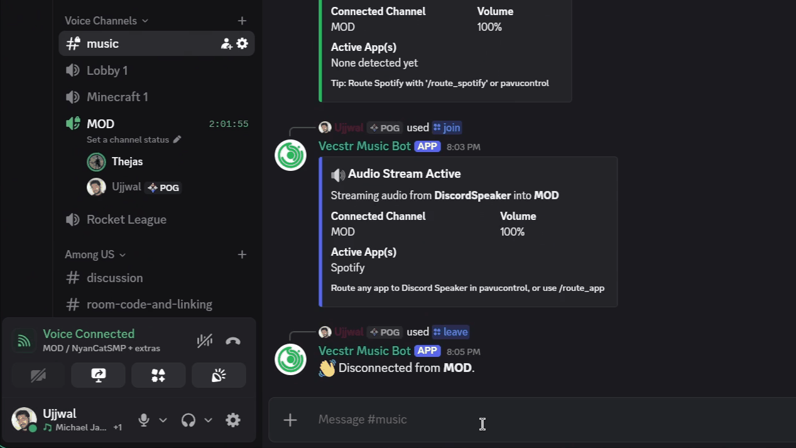
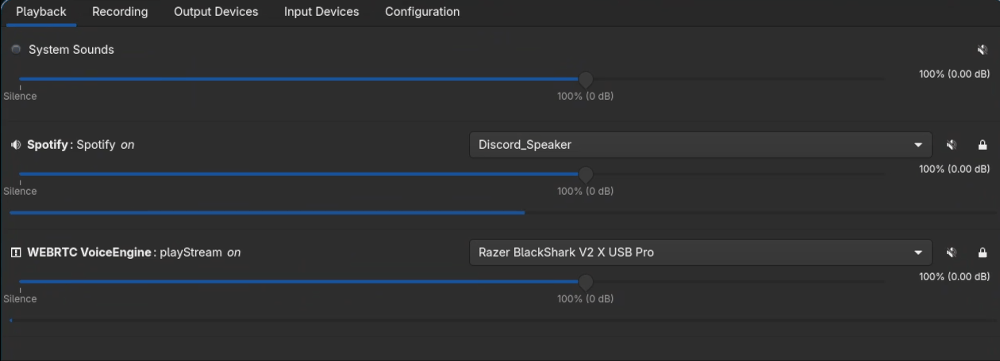
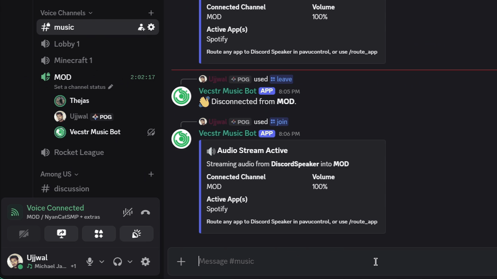
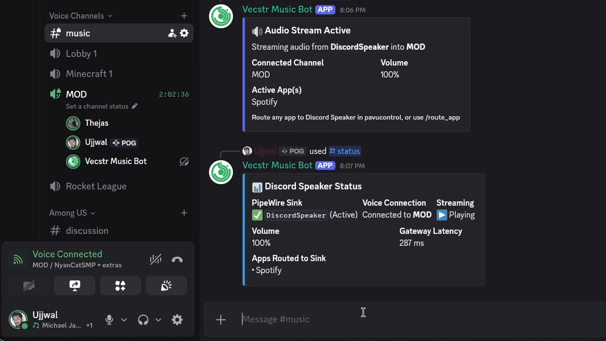

<div align="center">

# Discord Speaker

**Your desktop audio, in your Discord voice channel.**

Stream Spotify, your browser, media players, and games through a dedicated virtual audio output.

**Linux** · **PipeWire** · **Docker Compose** · **48 kHz stereo**

[Quick start](#quick-start) · [Audio routing](#audio-routing) · [Commands](#commands) · [Demos](#demos) · [Configuration](#configuration) · [Troubleshooting](#operations-and-troubleshooting)

</div>

---

## How it works

Discord Speaker creates a virtual audio output on your Linux desktop and streams
its monitor to Discord as 48 kHz stereo audio. Spotify is an easy example: play
music, switch Spotify's output to **Discord Speaker**, and the bot transmits that
playback. The same workflow works with Firefox, Chromium, VLC, MPV, games, or
multiple applications at once.

```text
Spotify / Browser / Media player / Game
                  │
                  ▼
       Discord Speaker virtual output
                  │
                  ▼
                FFmpeg
                  │
                  ▼
        Discord bot → Voice channel
```

- **Share any app.** Route one application or mix several into the same stream.
- **Skip music-service credentials.** No Spotify API keys, track URLs, or service-specific downloaders.
- **Listen locally too.** Enable optional monitoring on your speakers or headphones.

> **Live playback:** The bot captures desktop audio. Start playback in the application you want to share.

## Requirements

| Requirement | Details |
| :--- | :--- |
| Linux desktop | PipeWire, pipewire-pulse, and WirePlumber running |
| Docker | Docker Engine with Docker Compose v2 or later |
| Discord bot | A bot token and permission to add the bot to your server |
| Volume mixer (optional) | `pavucontrol` for per-application output selection |

The container includes Python, FFmpeg, libopus, and `pactl`. The desktop apps and
audio server run on the host. This setup targets native Linux Docker Engine;
a VPS needs its own audio source or a separate transport from your desktop.

## Quick start

### 1. Set up your Discord bot

1. Create an application and bot in the [Discord Developer Portal](https://discord.com/developers/applications).
2. Copy the bot token into `.env` as described below. Keep it private.
3. Enable **Message Content Intent** on the Bot page: this bot enables that intent
   for its fallback `!` commands.
4. Generate an installation URL with `bot` and `applications.commands` scopes.
   Grant **View Channels**, **Send Messages**, **Embed Links**, **Connect**, and
   **Speak**, then add the bot to your server. Channel overrides must permit it
   to view and connect to the intended voice channel.

### 2. Configure and launch Docker

For a new setup, run from the repository root. Keep your existing `.env` if you have already configured it:

```bash
cp .env.example .env
chmod 600 .env
# Edit .env and set DISCORD_BOT_TOKEN.
# Match HOST_UID/HOST_GID to `id -u` / `id -g`.
# Set PULSE_RUNTIME_DIR to your desktop's $XDG_RUNTIME_DIR/pulse.
docker compose up -d --build
docker compose logs -f bot
```

The token is passed at runtime and excluded from Git and the Docker build
context. Avoid running a second copy of the bot with the same token.

### 3. Share your first audio

1. Join a Discord voice channel and run `/join`.
2. Start playing music in the desktop Spotify app.
3. Open **pavucontrol → Playback**, find Spotify, and change its output to
   **Discord Speaker**. An older sink may appear as **Discord_Speaker**.
4. Everyone in the voice channel hears the routed playback.

For a shortcut, use `/route_spotify` while music is playing. You can also run
`/route_app application:spotify`.

## Audio routing

### Route any application

For Firefox, VLC, MPV, a game, or another desktop app, start its playback and
choose **Discord Speaker** as that app's output in your volume mixer. All apps
routed to the output are mixed into the same Discord stream.

You can also use `/route_app application:firefox` or
`/route_app application:vlc`. The command matches active playback streams by
application or process name, ignoring case, and moves all matching streams.
Playback must be active for a stream to be discoverable. Apps with native
PipeWire routing may need your desktop's PipeWire graph/mixer rather than the
PulseAudio app list.

### Listen locally

By default, routed audio plays in Discord only. To hear it locally as well:

```bash
docker compose exec bot ./audio_ctl.sh enable-loopback
# Turn local monitoring back off:
docker compose exec bot ./audio_ctl.sh disable-loopback
```

## Commands

| Slash command | Prefix command | Action |
| :--- | :--- | :--- |
| `/join [channel]` | `!join` | Join a voice channel and start streaming the virtual output |
| `/leave` | `!leave` | Stop streaming and disconnect |
| `/status` | `!status` | Show voice and audio status; slash status lists routed apps |
| `/route_app <application>` | `!route_app <application>` | Route any matching active app to Discord Speaker |
| `/route_spotify` | `!route` | Convenience shortcut for Spotify playback |
| `/volume <1-200>` | `!volume <1-200>` | Adjust the volume sent to Discord |

## Demos

<table>
  <tr>
    <th width="50%">Join a voice channel</th>
    <th width="50%">Stream audio</th>
  </tr>
  <tr>
    <td></td>
    <td></td>
  </tr>
  <tr>
    <th>Check status</th>
    <th>Leave a voice channel</th>
  </tr>
  <tr>
    <td></td>
    <td></td>
  </tr>
</table>

## Configuration

| Variable | Default | Meaning |
| :--- | :--- | :--- |
| `DISCORD_BOT_TOKEN` | Required | Discord bot token; keep in local `.env` |
| `SINK_NAME` | `DiscordSpeaker` | Internal sink name; its monitor is `<name>.monitor` |
| `AUTO_CREATE_SINK` | `true` | Create the virtual output when the bot connects |
| `COMMAND_PREFIX` | `!` | Prefix for fallback text commands |
| `HOST_UID` / `HOST_GID` | `1000` / `1000` | Desktop user's numeric UID/GID |
| `PULSE_RUNTIME_DIR` | `/run/user/1000/pulse` | Host directory containing the `native` socket |

Docker sets `PULSE_SERVER=unix:/run/host/pulse/native` inside the container.
The socket directory is mounted so recreated sockets remain visible after a
host audio restart. The process runs without root privileges, with a read-only
root filesystem and a small writable `/tmp`.

## Operations and troubleshooting

### Everyday operations

```bash
# The desktop audio socket must exist before starting.
test -S "${XDG_RUNTIME_DIR}/pulse/native"

# Check host audio access without logging into Discord.
docker compose run --rm --no-deps bot pactl info

# Inspect or route through the running container.
docker compose exec bot ./audio_ctl.sh status
docker compose exec bot ./audio_ctl.sh route-app firefox

# Rebuild after changing src/.
docker compose up -d --build

# Stop the bot.
docker compose down
```

### Troubleshooting

- **Audio connection refused:** verify pipewire-pulse is running in your desktop
  session and that the runtime directory and UID/GID match. This setup uses
  PipeWire's PulseAudio compatibility server; cookie-authenticated standalone
  PulseAudio may require additional cookie configuration.
- **No sound:** ensure the app is playing into Discord Speaker, the bot has joined
  a voice channel, and its Discord speaking permissions are allowed.
- **Voice handshake fails:** check bot logs, channel permissions, and outbound
  network access.
- **Privileged intents error:** enable Message Content Intent for the bot.
- **Host audio restarted:** once the server returns, use `/leave` then `/join`
  to restart capture.

Container health checks verify audio-server access only. Discord errors appear
in logs. Docker does not automatically restart a container just because it is
unhealthy. Stopping the container leaves the host's virtual output in place.
To remove it, first `/leave`, then run
`docker compose exec bot ./audio_ctl.sh teardown` before stopping the container.

The audio socket allows the bot to record and control host audio routing, just
as the native application does. Read-only mounting does not restrict these
protocol operations. Desktop audio must remain available while streaming.

## Repository layout and development

```text
src/                 Bot, audio helper, and Python dependencies
Dockerfile           Runtime image
compose.yaml         Host audio integration and runtime configuration
.env.example         Shareable configuration template
.github/workflows/   Syntax checks, routing tests, and Docker build
tests/               Audio routing regression tests
```

```bash
python3 -m venv .venv
. .venv/bin/activate
python -m pip install -r src/requirements.txt
python -m unittest discover -s tests -v
bash -n src/audio_ctl.sh
```

CI uses a placeholder token and never connects to Discord or the desktop audio
server. Keep `.env`, virtual environments, and generated files out of commits.
Only the explicitly allowed application files enter the Docker build context.

References: [Discord app setup](https://github.com/discord/discord-api-docs/blob/main/developers/quick-start/getting-started.mdx),
[Compose services](https://docs.docker.com/reference/compose-file/services/)
and [Pulse server addresses](https://wiki.freedesktop.org/www/Software/PulseAudio/Documentation/User/ServerStrings/).
